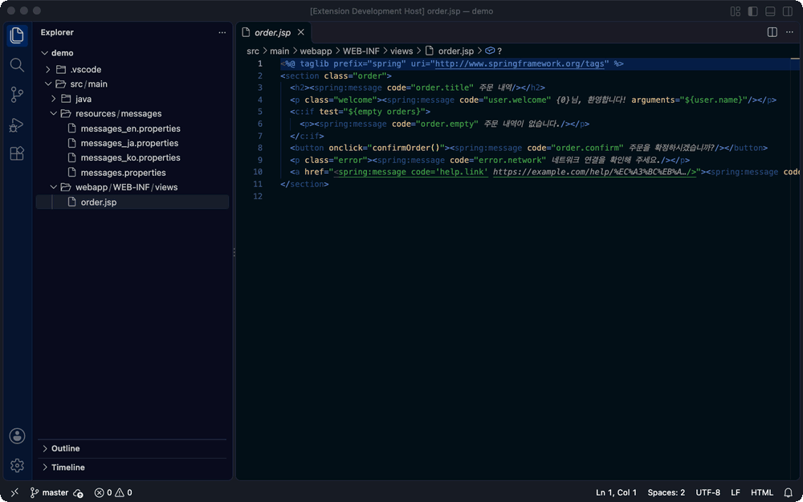
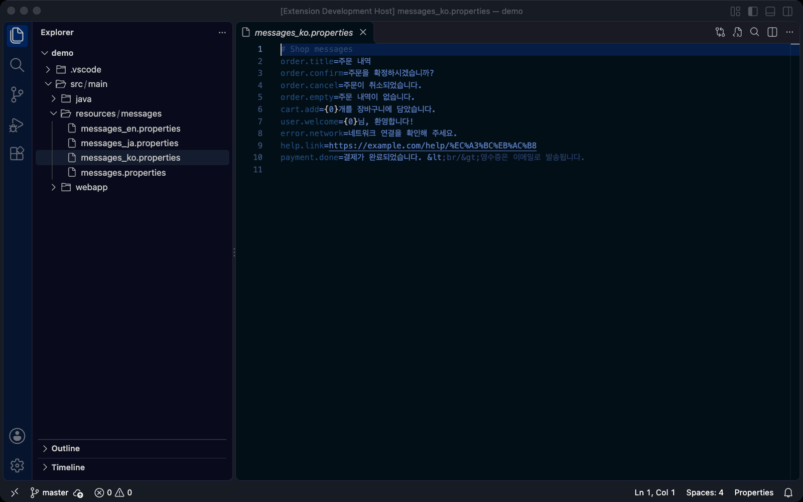
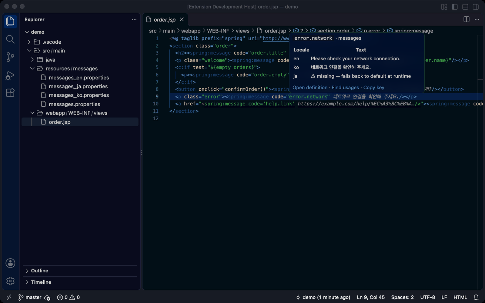
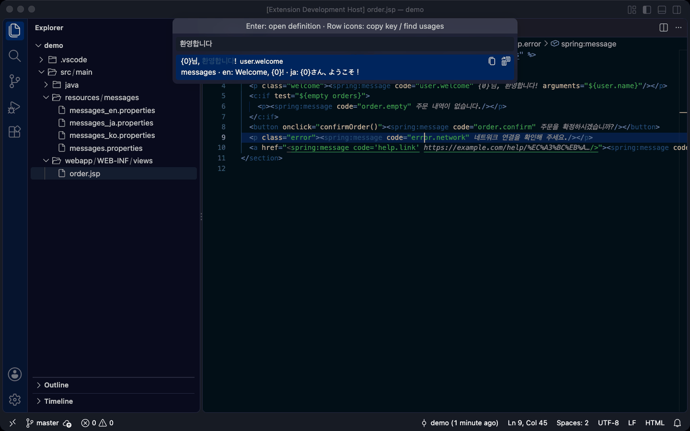
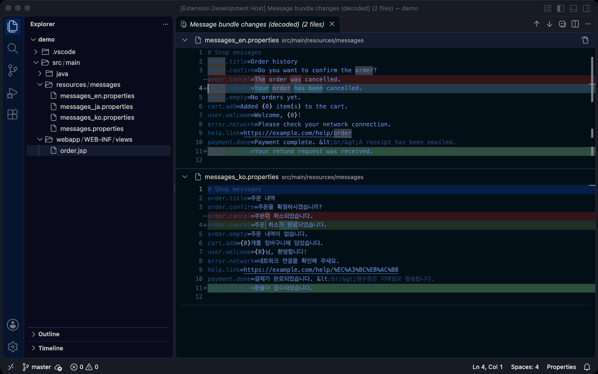

# Properties Lens

**Java `.properties` 다국어 번들을 `\uXXXX` 가 아닌 실제 문장으로 읽고, 검색하고, 비교합니다.**

[English README](README.md)



Java 다국어 번들은 한글·일본어 같은 비ASCII 문자를 `\uC8FC\uBB38 \uB0B4\uC5ED` 처럼 escape 해서 저장합니다.
IntelliJ 는 이를 풀어서 보여 주지만 VS Code 는 escape 그대로 보여 줍니다. 기존 변환 확장은 파일 자체를 바꾸고,
일부는 `%EB%A6%AC` 같은 URL 인코딩까지 잘못 풀어 버립니다.

Properties Lens 는 파일을 절대 수정하지 않습니다. 대신 **읽기 전용 한글 보기**, **한글 diff**, **다국어 검색**,
**JSP·JS·Java 키 옆 문장 표시**를 제공합니다.

## 기능

### 한글 보기

`messages_ko.properties` 를 열면 바로 `order.title=주문 내역` 으로 보입니다. `\uXXXX` 만 풀고 URL 인코딩(`%EC%A3%BC`),
HTML 엔티티(`&lt;br/&gt;`) 등은 저장된 그대로 둡니다. 원본이 필요하면 편집기 제목줄 버튼으로 엽니다(그 세션 동안 읽기 전용).



### 키 옆 문장 표시

JSP·JS·Java 등 소스 파일의 키 옆에 문장이 표시됩니다. 마우스를 올리면 모든 언어 문장이 보이고 빠진 번역이 표시됩니다.
없는 키(오타)는 경고색으로 보입니다. `F12` / `Cmd+클릭` 으로 한글 보기의 정의 줄로 이동합니다.



### 다국어 검색 — `Cmd+Alt+M` / `Ctrl+Alt+M`

모든 번들을 **어떤 언어 문장으로든** 또는 키로 검색합니다. 새 기능에 기존 문장을 재사용할 수 있는지 판단할 때 유용합니다.
`Enter` 는 정의로 이동, 줄 오른쪽 아이콘은 키 복사 / 사용처 찾기입니다.



### 한글 diff

편집기 제목줄이나 소스 제어 우클릭 메뉴의 *Compare with HEAD (decoded)*, 또는 *Show All Bundle Changes (decoded)* 로
변경된 번들 파일 전체를 한 화면에서 비교합니다. 번들을 다시 생성한 직후 확인할 때 씁니다.



### 동기화

번들을 스프레드시트·스크립트·Maven/Gradle 작업 등으로 생성한다면 `propertiesLens.syncCommand` 에 그 명령을 적으세요.
상태 표시줄에서 실행하고 끝나면 바로 한글 diff 로 변경 사항을 볼 수 있습니다.

## 시작하기

설치하고 다국어 번들이 있는 프로젝트를 열면 됩니다. Spring `<spring:message code="…">`, JSTL `<fmt:message key="…">`,
`getMessage("…")` 는 설정 없이 동작합니다. 다른 키 형식은 패턴을 추가하세요.

```jsonc
// .vscode/settings.json
{
  "propertiesLens.primaryLocale": "ko",
  "propertiesLens.keyPatterns": [
    "<spring:message\\s[^>]*?code\\s*=\\s*\"([^\"]+)\"",
    "\\$\\.i18n\\.([A-Za-z_$][\\w$]*)",          // $.i18n.KEY
    "\\bt\\(\\s*'([^']+)'"                        // t('KEY')
  ],
  "propertiesLens.syncCommand": "./gradlew generateMessages"
}
```

## 번들로 보는 파일

같은 폴더에 `<이름>_<locale>.properties` (와 기본 파일 `<이름>.properties`) 가 있고 `<locale>` 이 실제 언어 코드
(`ko`, `en`, `ja`, `zh_CN` …) 인 묶음입니다. `application.properties`, `jdbc_dev.properties` 같은 파일은 건드리지 않습니다.
*Open Decoded View* 명령은 어떤 `.properties` 파일에도 쓸 수 있습니다.

## 설정

| 설정 | 기본값 | 설명 |
|---|---|---|
| `propertiesLens.bundleGlob` | `**/*.properties` | 대상 파일. 그중 locale 묶음만 번들 |
| `propertiesLens.exclude` | `**/{target,build,node_modules,out,dist,.git}/**` | 제외 파일 |
| `propertiesLens.primaryLocale` | `""` | 키 옆·검색에 보여 줄 언어. 비우면 VS Code 표시 언어, 그다음 기본 파일 |
| `propertiesLens.keyPatterns` | `spring:message`, `fmt:message`, `getMessage(` | 키를 찾는 정규식. 캡처 그룹 1 이 키 |
| `propertiesLens.decorateFiles` | `**/*.{jsp,jspf,tag,js,ts,html,java}` | 문장 표시·hover·정의 이동 대상 파일 |
| `propertiesLens.syncCommand` | `""` | 번들을 다시 만드는 셸 명령 |
| `propertiesLens.syncCwd` | `""` | 동기화 명령 작업 디렉터리 (워크스페이스 기준) |
| `propertiesLens.autoOpenDecoded` | `true` | 번들 파일을 열면 자동으로 한글 보기 |

신뢰하지 않는 작업 영역에서는 `syncCommand`, `syncCwd` 를 사용자 설정에서만 읽습니다.

## 읽기 전용 원칙

- 확장은 `.properties` 파일에 쓰지 않습니다. 문장은 원본(스프레드시트, 생성기 등)에서 고치세요.
- 충돌 표시가 있거나 저장하지 않은 변경이 있는 파일은 한글 보기로 바꾸지 않습니다.
- 제어 문자와 줄·단락 구분 문자(`\u2028`, `\u2029`)는 줄이 밀리지 않도록 escape 그대로 둡니다.

## 알려진 제한

- `F12` 는 기본 언어 줄로 이동합니다. 다른 언어는 hover 에서 보세요.
- `decorateFiles` 를 바꾸면 hover·정의 이동은 창을 다시 로드해야 반영됩니다.
- 열어 둔 diff 의 HEAD 쪽은 커밋·브랜치 전환 후 갱신되지 않습니다. 다시 여세요.

## 라이선스

[MIT](LICENSE)
